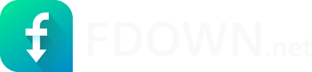

# 🚀 FBDock — Facebook Video Downloader Online

<p align="center">
  
</p>

<p align="center">
  <strong>Fast, Modern & Clean Facebook Video Downloader</strong><br>
  A lightweight, high-performance web application to download any public Facebook video or Reel in true HD and SD quality.
</p>

<p align="center">
  
  
  
  
  
</p>

---

## 📖 About The Project

**FBDock** is a modern, advertisement-free, and high-speed online Facebook video downloader. It enables users to extract and download high-definition (HD) and standard-definition (SD) Facebook videos and Reels instantly without intrusive pop-ups, redirects, or unnecessary page reloads.

Built with performance in mind, FBDock delivers a seamless experience across all platforms—smartphones, tablets, and desktop browsers.

---

## ✨ Key Features

### 🎬 1. True Dual Resolution (HD & SD Quality)
- **HD Quality:** Downloads videos in their original maximum available resolution (720p / 1080p).
- **Normal Quality (SD):** Optimized for low bandwidth and smaller file sizes (360p / 480p). If a video only provides a single stream upstream, the backend's real-time **FFmpeg Engine** automatically downscales it to 480p on-the-fly.

### 🏷️ 2. Smart Filename Sanitization
- Automatically names downloaded files after the actual video caption/title (e.g., `Video_Title_HD.mp4` or `Video_Title_SD.mp4`).
- Strips invalid filesystem characters across Windows, macOS, Android, and iOS for error-free saving.

### ⚡ 3. Instant 1-Click Download (Zero Reload / No Blank Tabs)
- Direct streaming download without opening blank tabs or redirecting away from the page.
- Fully compatible with native browser download managers as well as external tools like **Internet Download Manager (IDM)**.
- Guaranteed single-file download per click (no duplicate downloads).

### 📱 4. Clean & Responsive User Experience
- Clean video card preview with thumbnails and metadata.
- Built-in interactive step-by-step guides for both PC/Mac and iOS/Android users.
- Live progress indicator and instant status feedback.

---

## 🛠️ Tech Stack

| Component | Technology | Role |
|---|---|---|
| **Backend** | Node.js (HTTP / Stream API) | Real-time proxy streaming and API endpoints |
| **Video Engine** | FFmpeg (`ffmpeg-static`) | Real-time 480p downscaling & transcoder fallback |
| **Scraper & Parser** | `rahad-all-downloader-v2` & `snapsave` | Multi-engine Facebook video URL extraction |
| **Frontend** | Vanilla JavaScript & HTML5 | Fast, dependency-free interactive UI |
| **Styling** | Custom CSS3 & Responsive Grid | Modern glassmorphism & mobile-first responsive layout |

---

## 🚀 Getting Started

Follow these steps to run the project locally on your machine:

### Prerequisites
Make sure you have [Node.js](https://nodejs.org/) (version 18 or newer) installed.

### 1. Clone the Repository
```bash
git clone https://github.com/saifullahtanim/fbdock.git
cd fbdock
```

### 2. Install Dependencies
```bash
npm install
```

### 3. Start the Server
```bash
npm start
```

### 4. Open in Browser
Visit the following URL in your web browser:
```text
http://localhost:3000
```

---

## 📁 Project Structure

```text
fbdock/
├── api/
│   ├── download.js         # Video extraction & multi-engine fallback
│   ├── stream.js           # Stream proxying endpoint
│   └── contact.js          # Contact submission handler
├── css/
│   ├── style.css           # Main custom stylesheet & UI styling
│   └── bootstrap.min.css   # Responsive grid layout
├── js/
│   ├── downloader.js       # Client-side download handler & UI logic
│   └── scripts.js          # Utility scripts
├── img/                    # Icons, illustrations, and tutorial assets
├── index.html              # Main landing page (FBDock)
├── index-2.html            # Secondary template
├── server.js               # Node.js backend server & FFmpeg stream pipeline
├── package.json            # Project dependencies & scripts
└── README.md               # Documentation
```

---

## 🔒 Privacy & Disclaimer

> **Note:** FBDock does not host, store, or archive any copyrighted videos on its servers. All media streams are delivered directly through real-time proxies from Facebook's Content Delivery Network (CDN). This project is intended strictly for personal and educational use.

---

## 👨‍💻 Author & Credits

Developed with ❤️ by **[Saifulla Tanim](https://github.com/saifullahtanim)**.  
All rights reserved © FBDock.
